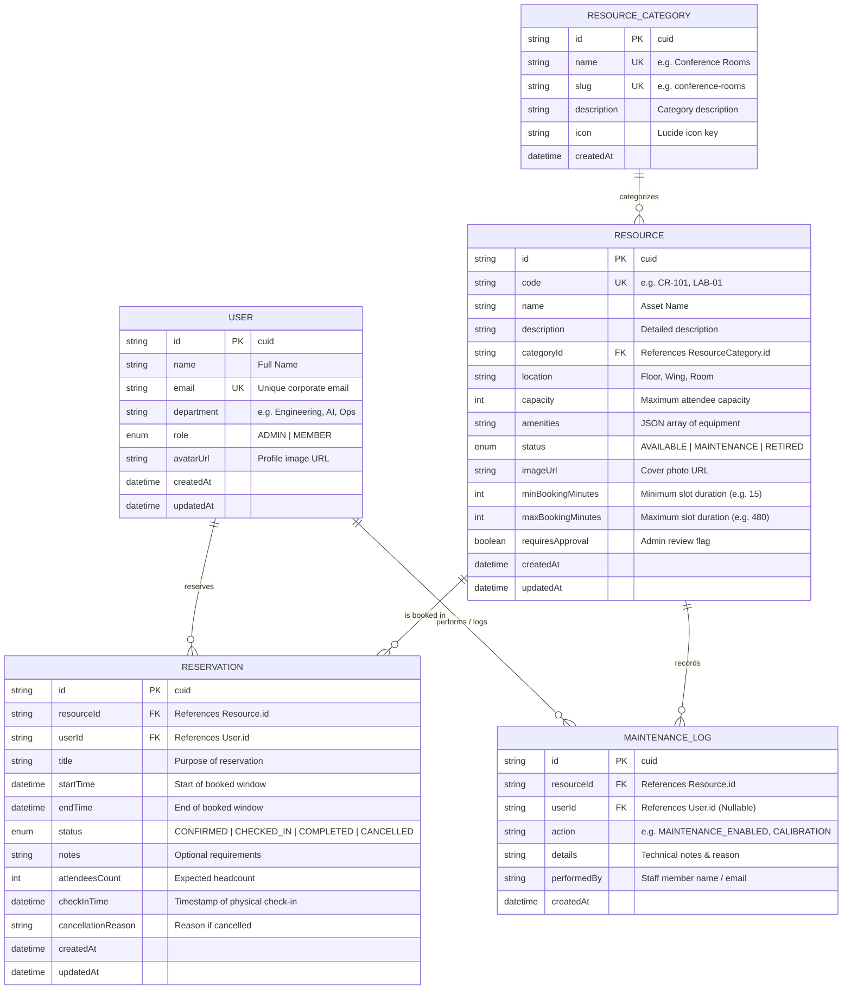

# Entity Relationship (ER) Diagram
## PrimeWave Resource Reservation Management System

This document outlines the database design, entity schemas, and relational architecture of the **Resource Reservation Management System** built with **PostgreSQL** and **Prisma ORM**.

---

## 1. Visual Entity Relationship Diagram (Mermaid)

---

## 2. Relational Architecture & Cardinality

### A. `ResourceCategory` → `Resource` (1 : N)
- Each category (e.g., *Conference & Meeting Rooms*, *Hardware & AV Tech*, *Laboratories*) groups multiple physical resources.
- `Resource.categoryId` references `ResourceCategory.id` with `onDelete: Cascade`.

### B. `User` → `Reservation` (1 : N)
- A corporate user can create multiple bookings across different resources and dates.
- `Reservation.userId` references `User.id` with `onDelete: Cascade`.

### C. `Resource` → `Reservation` (1 : N)
- A physical resource contains multiple time-sliced reservation records.
- Overlapping time conflicts (`startTime < newEnd && endTime > newStart`) for active reservations on the same resource are strictly blocked via atomic database transactions.

### D. `Resource` → `MaintenanceLog` (1 : N)
- Tracks full audit history of repairs, annual safety inspections, and offline periods.

---

## 3. Performance & Indexing Strategy

To guarantee rapid queries and zero race conditions under high concurrent booking traffic:

| Table | Index Columns | Purpose |
|---|---|---|
| `reservations` | `[resourceId, startTime, endTime]` | **Crucial:** Accelerates overlap conflict checks to <5ms |
| `reservations` | `[userId]` | Fast lookup of individual user booking history |
| `reservations` | `[status]` | High-speed filtering of active vs cancelled bookings |
| `resources` | `[categoryId]` | Category filtering |
| `resources` | `[status]` | Instant lookup of `AVAILABLE` vs `MAINTENANCE` facilities |

---

## 4. How to View / Share this Diagram

1. **GitHub Markdown Rendering**: This file uses standard GitHub-flavored Mermaid syntax and renders natively inside GitHub repositories.
2. **Mermaid Live Editor**: Copy the Mermaid block above into [mermaid.live](https://mermaid.live/) to export high-resolution PNG/SVG images for submission.